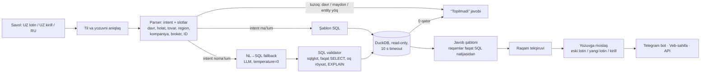

# UZEX AI-agent — yeçim tavsifi

*Qöqon universiteti Andijon filiali (KUAF) iştirokçilari tomonidan tayyorlandi.*

## 1. Muammo va talablar

Birja bitimlari reyestri (500 000 bitim, 03.01.2022–30.10.2026) böyiça rus va özbek tilidagi
savollarga **aniq, maʼlumotga asoslangan** javob beradigan agent kerak. Javob 90 soniyadan oşmasligi,
maʼlumotda yöq narsa töqib çiqarilmasligi va topilmasa buni oçiq aytişi şart.

## 2. Arxitektura



Texnologiyalar: Python 3.12, DuckDB, sqlglot, rapidfuzz, aiogram 3 (Telegram, polling),
FastAPI (veb-sahifa + `/ask` API), OpenAI-mos LLM mijozi (ixtiyoriy fallback), Docker.

## 3. Javoblar qanday tekşiriladi

1. **LLM javob matnini yozmaydi.** Barça raqam, nom, INN va kod SQL natijasidan dastur orqali
   şablonga qöyiladi. LLM (bölsa) faqat SQL yozadi; uning natijasi ham şu şablonlar orqali çiqadi.
2. **Raqam tekşiruvi** (`app/validator.py: unverified_numbers`): javobdagi har bir raqam va sana SQL
   natijasidagi qiymatlardan biriga (yaxlitlaş ±0,01) yoki savoldagi filtrga mos kelişi kerak.
   Mos kelmagan raqam logga yoziladi va testda xato hisoblanadi.
3. **“Topilmadi”ning 4 turi:**
   - davr maʼlumotlardan taşqarida (masalan, 2021-yil yoki 2026-yil dekabr);
   - kompaniya yoki INN yöq (taxminiy ösxaş nom “topib” berilmaydi);
   - körsatkiç maʼlumotlarda yöq (marja, foyda, soliq);
   - filtrlar töğri, lekin natija böş.
4. **Entity linking ehtiyotkor:** INN aniq moslik; nomlar kirill/lotin/yangi alifbo normalizatsiyasidan
   keyin taqqoslanadi. Bunda “MCHJ”, “Trade”, “Group” kabi umumiy sözlar hisobga olinmaydi va kompaniya
   nomidagi **har bir** farqlovçi söz savolda bölişi kerak (“Zumrad Super Trade” → topilmadi,
   “… Trade MCHJ” degan boşqa firma emas). Bir xil nomli firmalar INN bilan ajratiladi.
5. **SQL xavfsizligi:** DuckDB `read_only`, `enable_external_access=false`, faqat `SELECT/WITH`,
   jadvallar oq röyxati, fayl funksiyalari taqiqlangan, `EXPLAIN`, `LIMIT`, 10 s timeout.
6. **Şaffoflik:** har javobning özida **“🔎 Qanday hisoblandi”** bandi (formula va usul), filtrlar
   (davr, holat, valyuta), çiqarib taşlangan annul bitimlar soni va manba (bitim/kontrakt raqamlari)
   yoziladi. Telegramdagi **“🧾 SQL sörov”** tugmasi va veb-sahifa bajarilgan SQL sörovning özini körsatadi.
7. **Javob savol tilida:** maʼlumotdagi holatlar, regionlar, ölçov birliklari, kontrakt turlari va asosiy
   tovar nomlari savol tiliga öğiriladi (tovarning reyestrdagi aniq nomi «…» ichida saqlanadi);
   özbekça javob savol yozuvida — eski lotin, **yangi alifbo (ö ğ ç ş)** yoki kirill.
8. **Regressiya testlari:** `scripts/smoke_test.py` (33 savol) va `scripts/eval.py` (62 savol).
   Eval'dagi oltin javoblar agent kodidan **mustaqil**, qölda yozilgan SQL bilan hisoblanadi.

## 4. Maʼlumot tozalaş

- Summalardagi minglik böşliqlar olib taşlanadi, sanalar `DD.MM.YYYY` dan DATE turiga öğiriladi.
- `volume = Количество × Лот`, `unit_price = Сумма ÷ volume`.
- Eksport (USD) bitimlari sömga **har bir bitim öz sanasidagi kurs böyiça** öğiriladi.
- Region: `deals` (özbekça) va `contracts` (ruscha) nomlari luğat orqali boğlanadi.
- Matn normalizatsiyasi: kirill→lotin transliteratsiya, apostrof turlari, yangi alifbo (ö ğ ç ş),
  tovar nomlari (ТН ВЭД kodi orqali guruhlanadi).

## 5. Qabul qilingan farazlar

| Masala | Qaror |
|---|---|
| “Bugun” | 30.10.2026 (maʼlumotlar oxirgi sanasi). “Ötgan oy” = sentabr 2026, “ötgan yil” = 2025 |
| Yilsiz oy | Şu oyning 30.10.2026 gaça bölgan oxirgisi (noyabr → 2025-yil noyabr) |
| Annul bitimlar | Summa, hajm va narxda **hisobga olinmaydi** (bitim amalga oşmagan); **bitimlar sonida** barça holatlar. Javobda aytiladi |
| “Ijro etilgan” | Исполнен + Исполнен(Частично) |
| “Tölangan” | Оплачен + Исполнен + Исполнен(Частично) |
| “Bekor qilingan” | Аннулирован(Не оплачен) |
| Kurs | Bitim sanasidagi kurs; sana uçun kurs bölmasa — oxirgi maʼlum kurs (bu javobda aytiladi) |
| Javob tili | Savol tili; özbekça javob savol yozuvida (eski lotin, yangi lotin yoki kirill). Maʼlumotdagi nomlar özgartirilmaydi |

## 6. Qöllab-quvvatlanadigan savol turlari

Jami summa / bitimlar soni / hajm; örtaça, min va max narx; top-N (kompaniya, tovar, region, broker);
kompaniya profili (nom yoki INN); tovar statistikasi; kontrakt va bitim kartoçkasi; eksport (USD va
sömda); holatlar, kontrakt şakli/turi va savdo turi ulushi (%); bitimning örtaça summasi; röyxatdan ötgan kontraktlar soni; yetkazib beriş (yetkazilmagan lotlar); eng arzon/qimmat region yoki kompaniya; eng faol xaridorlar; USD kursi (sana yoki davr); eng katta, eng kiçik, eng birinçi
va eng oxirgi bitim; noyob xaridor va sotuvçilar soni; yillar va oylar böyiça taqqoslaş (% özgariş).
Nisbiy davrlar: ötgan yil/oy/hafta, bu yil, çoraklar (1-çorak, III квартал), yarim yillik,
“oxirgi N kun/oy”, “yanvar–mart”, “с … по …”, bugun/kecha.

## 7. Test natijalari

`python scripts/eval.py --md` (LLM'siz, MacBook):

| Guruh | Savollar | Töğri |
|---|---:|---:|
| özbek, eski lotin | 19 | 19 |
| özbek, kirill | 6 | 6 |
| özbek, yangi lotin | 5 | 5 |
| rus | 32 | 32 |
| şundan tuzoq savollar (“topilmadi”) | 11 | 11 |
| **Jami** | **62** | **62 (100%)** |

Örtaça javob vaqti 0,02 s, eng uzuni 0,04 s. Tasdiqlanmagan raqamli javoblar: 0.
Eslatma: test töplami işlab çiqiş davomida tuzilgan, şuning uçun yangi turdagi savollarda aniqlik
bundan past böliş mumkin.

## 8. Çeklovlar va keyingi qadamlar

- Şablonlarga tuşmagan savollar NL→SQL fallback'ga ötadi; LLM ulanmagan bölsa, agent savolni
  aniqlaştirişni söraydi (taxminiy javob bermaydi).
- Keyingi qadamlar: tovar nomlari uçun vektor qidiruv, LLM SQL'ni self-consistency (2–3 variant)
  bilan tekşiriş, savollar logi (`logs/qa.jsonl`) asosida yangi şablonlar.

## Işga tuşiriş

```bash
python scripts/build_db.py               # CSV → data/uzex.duckdb
python -m app.cli --debug "savol"         # terminal
uvicorn app.api:app --port 8000          # veb-sahifa: http://localhost:8000/
python -m app.bot                        # Telegram (TELEGRAM_BOT_TOKEN .env da)
docker compose up -d --build             # bot + web, restart: always
```

---

## Google Forma uçun qisqa tavsif

UZEX birja bitimlari böyiça özbek (lotin, kirill, yangi alifbo) va rus tilidagi savollarga javob beradigan
AI-agent: Telegram bot va veb-sahifa. Savol tahlil qilinadi (til, davr, holat, tovar, region, kompaniya,
broker), keyin tayyor SQL şablon orqali DuckDB'da hisoblanadi; şablon bölmasa — LLM SQL yozadi va u
validator'dan (faqat SELECT, oq röyxat, read-only, timeout) ötadi. **LLM javob matnini yozmaydi:**
barça raqam va nomlar SQL natijasidan şablonga qöyiladi, javobdagi har bir raqam natija bilan qayta
soliştiriladi. Maʼlumot bölmasa (davr taşqarida, kompaniya yöq, körsatkiç yöq, natija böş) agent
“topilmadi” deydi. Javobda filtrlar, annul bitimlar va manba (bitim/kontrakt raqamlari) körsatiladi,
javobda “Qanday hisoblandi” bandi bor, “SQL” tugmasi esa sörovning özini oçadi. Javob savol tilida va
yozuvida (rus, özbek lotin, yangi alifbo, kirill). Qöqon universiteti Andijon filiali (KUAF) iştirokçilari
tomonidan tayyorlandi. Texnologiyalar: Python, DuckDB, sqlglot, rapidfuzz,
aiogram, FastAPI, Docker. Tekşiruv: oltin javoblari mustaqil SQL bilan hisoblangan 62 ta savol
(şundan 11 tasi tuzoq) — 62/62, örtaça javob vaqti 1 soniyadan kam.
